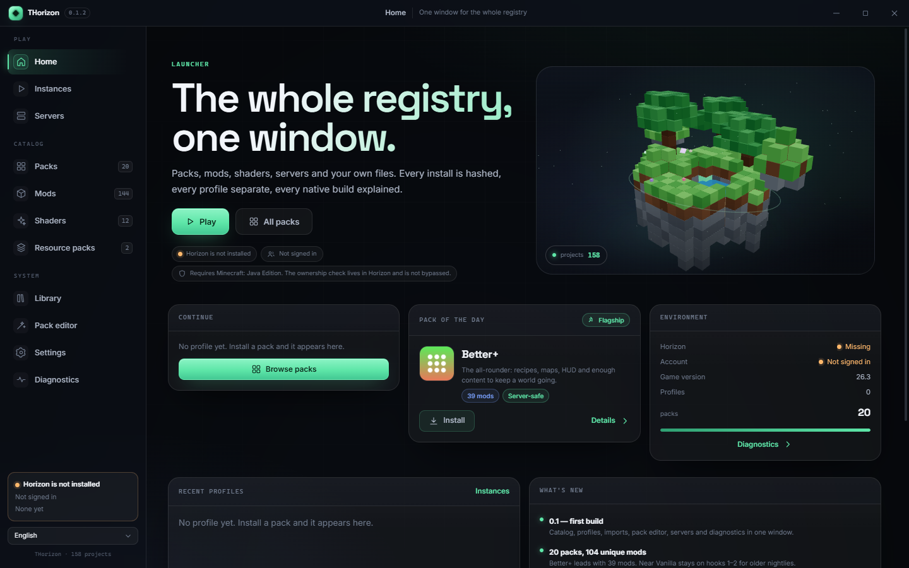
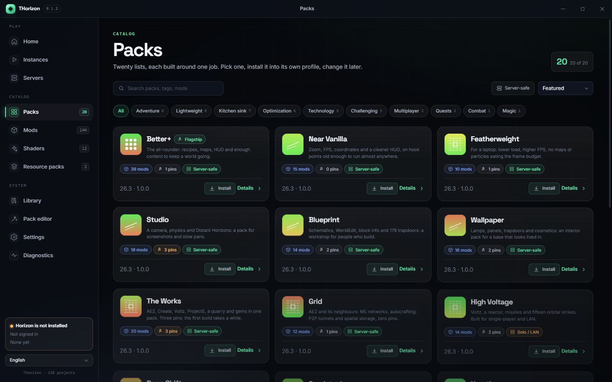
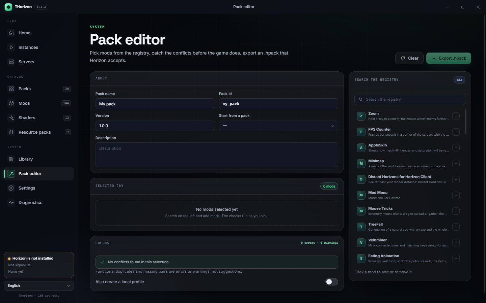

# THorizon launcher

The desktop launcher for **Horizon**: packs, mods, shaders, resource packs, servers and
your own files in one window. Electron + React 19 + TypeScript, with a 3D home scene,
profiles, a pack editor and a diagnostic report.

THorizon is an independent project. Playing Horizon requires a Microsoft account that
owns Minecraft: Java Edition; the check lives in the official client and is not
bypassed. The launcher stores no account tokens.

## Screens

| Home | Packs |
|---|---|
|  |  |

| Pack editor |
|---|
|  |

## Run

```bash
npm install
npm run dev          # Electron window with HMR
npm run build        # out/main, out/preload, out/renderer
npm start            # preview the built app
```

The catalog data is copied from `../site` when the archive is present. The generated
JSON and the local CLI index are committed, so a standalone checkout builds without
the archive.

## Checks

```bash
npm run typecheck    # tsc, strict, no any in app code
npm test             # 20 vitest checks: settings, catalog, editor, CLI parsing, UPnP, en/ru parity
npm run smoke        # builds, launches Electron, 25 UI checks + screenshots in out/shots
npm run smoke:logic  # mock CLI: install → profile → play → native build → mod install → backup → server
npm run dist:win     # NSIS installer in release/
npm run dist:linux   # AppImage + deb
```

The smoke script writes screenshots for the home (dark and light), packs, pack detail,
mods, drawer, servers, library, editor, settings, diagnostics, onboarding and the
Russian interface.

## What works without Horizon installed

- the whole catalog (20 packs, 144 mods, 12 shaders, 2 resource packs), search and filters;
- profiles: create, inspect, delete, per-profile launch options, backup now;
- Library: import `.hmod` / `.hnmod` / `.hpack` / `.hshader` / `.zip`, enable/disable,
  move to trash, SHA-256 shown for every file;
- pack editor: pick registry mods, catch cluster duplicates and half-installed pairs,
  export a TOML `.hpack` that Horizon accepts;
- servers list with a real TCP check, interactive console, UPnP mapping, whitelist
  and server.properties, start/stop through the CLI;
- settings (window, tray, autostart, updates, graphics, launch, backups, privacy),
  diagnostic zip, update channel.

## What needs the official client

`horizon-launcher` owns the game, the account and native builds. The launcher calls it
for installs, sign-in, play, native builds, server hosting and game logs. If it is not
installed, onboarding says so and the catalog stays usable.

When the CLI is present, installs use a local index bundle: the 158 registry projects
plus our 20 packs, with `.hpack` manifests shipped as `file://` resources. The user can
override it in Settings → Advanced (`Catalog index URL`).

## Architecture

```
src/main       window, tray, settings, CLI adapter, profiles, install queue,
               local files, servers, diagnostics, updater, IPC
src/preload    contextBridge only: window.api, no ipcRenderer in the renderer
src/shared     types, settings schema/merge, editor validation, TOML, CLI parsing
src/renderer   React UI: Home, Packs, Mods, Shaders, Resource packs, Servers,
               Instances, Library, Editor, Settings, Diagnostics, Onboarding
```

Security: `contextIsolation: true`, `nodeIntegration: false`, `sandbox: true`, CSP in
`index.html`, external links limited to `https:` and `mailto:`, all IPC inputs
validated in the main process. The renderer never touches Node, the filesystem or the
CLI directly.

The home scene is a lazy three.js chunk (instanced voxel island, pond, trees, crystals,
ring, sparks). It falls back to a 2D scene when WebGL is software or disabled, and
respects reduced motion.

## Data and licenses

Pack manifests and app code are MIT. Mods keep their own licenses, listed in each pack
page and in the packs repository. Files are linked from the registry or the author's
release, never rehosted.

Not affiliated with Mojang, Microsoft or the Horizon project.
